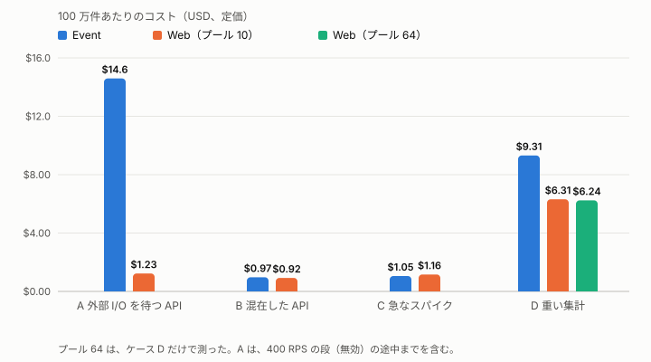
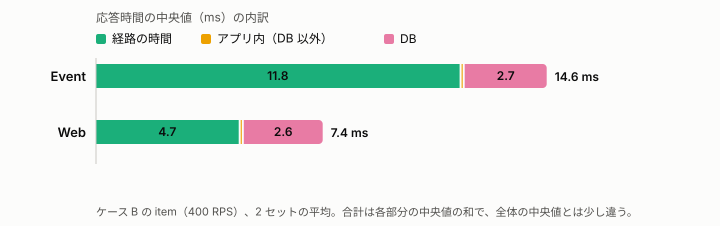
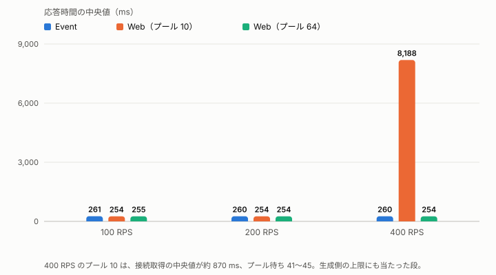
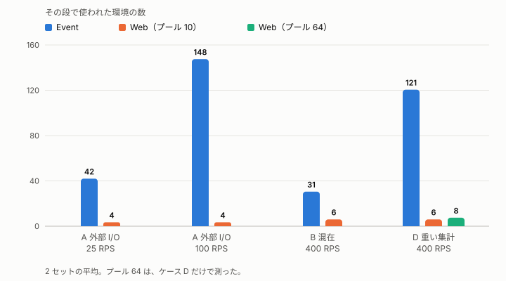
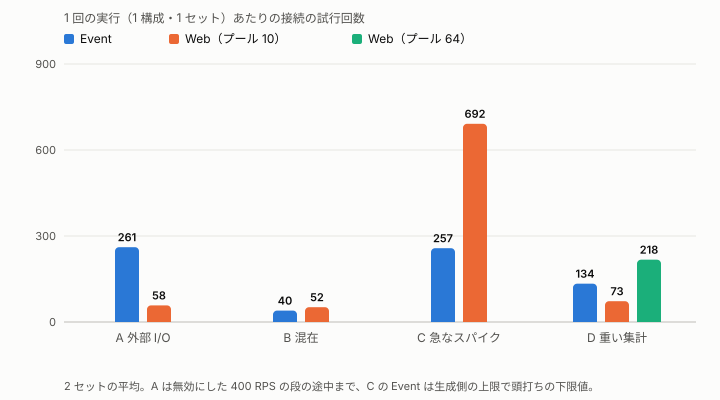

# 待ちの長い処理は Web が安く、短い処理は同じ

Lambda の Event Functions と Web Functions の比較（バックエンドは Aurora DSQL、2026-10-20 に測定）

**この文書の読み手:** AWS は使うが、この検証を知らない技術者。用語は [用語集](glossary.md) にある。

## 要旨
- **調べたこと:** Event と Web を、同じ DSQL をバックエンドに、実際のアプリに近い 4 つの使い方で比べた（東京、1 日、各 2 セット）。
- **答え 1:** 待ちが長い処理ほど、Web が安い。外部 API を 1 秒待つ処理では、約 12 分の 1 だった。
- **答え 2:** 短い処理では、コストはほぼ同じ。Web の方が、応答が数 ms 速い。差は関数の外の経路にあり、関数URL と Web のエンドポイントという入口の違いを含む。
- **答え 3:** Web は、1 つの環境の中で DSQL への接続を使い回す「DB 接続プール」（[用語集](glossary.md)）を共有するので、Event にはない「プールの上限」（接続の最大数）の設定が要る。既定値に近い上限 10 は、250 ms の集計を 400 RPS で受けると飽和した。環境内の同時処理数に合わせた上限 64 では起きなかった。
- **信頼できる範囲:** 一部の最大負荷は測れていない（[4-2](#4-2-信頼できる範囲)）。使い分けの目安は [2-6](#2-6-使い分けの目安)、仕組みは [3](#3-なぜそうなるか)。

## 1. Web は待ちの長い処理に向くはず、という仮説を、4 つの使い方で確かめた
**背景。** どちらの関数も、コードを「実行環境」（以下、環境。[用語集](glossary.md)）の中で動かし、リクエストが増えると Lambda が環境を増やす。Event は、1 つの環境が同時に 1 つのリクエストだけを処理する。Web は、1 つの環境が複数のリクエストを並列に処理する。この違いは、処理の中身（待つ、CPU を使う、DB を使う）で結果が変わるはずである。

**問い。** どんな処理で、Event と Web のどちらが、コスト・速さ・負荷への強さで有利か。

**やり方。** 同じ DSQL と東京の条件で、実際のアプリに近い 4 つの使い方を、2 つの関数に同じ負荷で流した。各ケースは 3 セット流し、1 セット目は捨てた。Event は、関数の外に付けた関数URL（IAM 認証）で、Web は、関数の Web エンドポイント（IamAuth）で受ける。負荷は、どちらにも署名つきで、その URL に送る。

| ケース | 処理の内容 | 負荷 | 見たい差 |
|---|---|---|---|
| A 外部 I/O を待つ API | DB の読み取り → 1 秒待つ（外部 API の代わり）→ 書き込み | 毎秒 25〜400 件 | 待ちの課金と、環境の数 |
| B 混在した API | 軽い読み取りが 7 割。N+1 の画面、重い集計、CPU 処理、書き込みが混ざる | 毎秒 50〜400 件 | 普通のアプリでの優劣 |
| C 急なスパイク | 毎秒 10 件から、毎秒 1,500 件に急に増える（2 回） | 毎秒 10 と 1,500 件 | 急な増加への強さ |
| D 重い集計 | 約 250 ms の集計だけが続く | 毎秒 100〜400 件 | DB 接続プールの待ち |

## 2. 結論

### 2-1. 待ちが長い処理ほど、Web の方が安い
外部 API を 1 秒待つ処理（ケース A）では、Web のコストは Event の約 12 分の 1 だった。100 万件あたり、Event は約 $15、Web は約 $1.2 である。Event は、待ち時間も課金されるためである。

250 ms の重い集計（ケース D）では、Web が約 3 分の 2 だった。一般的な API（ケース B）はほぼ同じで、急なスパイク（ケース C）は Event がわずかに安かった。

*図 1: 100 万件あたりのコスト（定価）。待ちが長いほど、Web の方が安い。*

### 2-2. 短い処理でも、Web の方が数 ms 速い。差は、関数の外の経路にあり、原因は切り分けていない
軽い読み取りの応答時間（中央値）は、Event が約 15 ms、Web が約 8 ms だった。

DB の時間（約 3 ms）とアプリ内の時間は、同じである。差はすべて、経路の時間にある。経路の時間は、応答時間から、アプリ内の時間を引いたものである。Event が約 12 ms、Web が約 5 ms だった。

*図 2: 差は、DB でもアプリ内でもなく、経路の時間にある。*

経路の時間には、入口（Event は関数URL、Web は Web のエンドポイント）、入口から関数への受け渡し、ハンドラでの要求と応答の変換、ネットワークが含まれる。アプリ内の時間は、変換の後から測っているので、変換は経路に入る。この測定では、これらを分けていない。したがって、差は、Web と Event の処理方式の違いだけでなく、関数URL の入口のオーバーヘッドである可能性がある。切り分けは、次の測定に回した（[付録 E](#e-未確認と次の測定)）。

CPU を使う処理は、Event（1 GB）が Web（2 vCPU）の約 2 倍遅い（46 ms と 23 ms）。Event の 1 GB は、CPU が約 0.57 vCPU 分しかないためと考えられる。

### 2-3. Web は、DB 接続プールの上限が環境内の同時処理数より小さいと詰まる
ここでのプールは、Web の各環境が持つ、DSQL への接続のプールである。上限は、1 つの環境が同時に使える DB 接続の数で、これを超えた DB 処理は空きを待つ。

プール上限 10 の Web は、250 ms の集計を毎秒 400 件で受けると飽和し、応答時間の中央値が約 250 ms から約 8 秒になった。プール上限 64 の Web は、250 ms のままだった。

*図 3: プール上限が環境内の同時処理数より小さい Web（プール 10）だけが、400 RPS で飽和した。*

原因は、プールの上限が、環境内の同時 DB 処理の上限になることである。環境は 6 つで、同時に処理できる DB 処理は 60 まで。1 件 250 ms なら、約 240 RPS が上限になる。Web は、プールが詰まっても、環境を増やさなかった。

Event では、この詰まりは構造上起きない。1 つの環境が同時に 1 つの要求だけを処理するので、DB 接続を共有せず（環境ごとに 1 本）、接続プールの待ちがない。同時処理の増加は、環境の増加で受ける。その代わりの限界は、同時実行数の上限と接続数に出る（[3-1](#3-1-event-は1-つの環境が-1-つの要求だけを処理するので待ちも環境も課金も増える)。今回は届いておらず、未測定）。したがって、この結果は Event との優劣ではなく、Web が持つ設定の注意点である。

対策は、DB 接続プールの上限を、環境内の同時 DB 処理数に合わせることである。上限 10 は、node-postgres の既定値であり、既定値のまま Web に移すと詰まりうる。

この段は、生成側の上限にも当たっているので、飽和の根拠は、接続取得の時間（中央値で約 870 ms、他は 1 ms 未満）に置く。

### 2-4. Event は、同時実行数ぶんの環境を使う
同じ負荷を処理するのに、Event は多くの環境を使い、Web は数個で済んだ。たとえば、ケース A の毎秒 100 件では、Event が約 150 環境、Web が約 4 環境だった。

*図 4: Event は、同時実行数ぶんの環境を使う。*

スパイクでの Event の環境数は、生成側の上限で頭打ちになった下限値である。

### 2-5. DSQL への接続は、Event は環境数に比例し、Web は環境数と使い方で決まる
Event は、環境ごとに DSQL への接続を 1 本張るので、接続の試行回数は、環境数と同じ程度になる。ケース A は約 260 回、急なスパイク（ケース C）は約 260 回で、環境数の多さがそのまま出た。

Web は、環境が少ないので、ケース A では接続が約 60 回と、Event の約 4 分の 1 だった。ただし、どのケースでも少ないわけではない。ケース C では、約 690 回と、Event より多かった。ケース D では、プール 64 の Web が Event より多く、プール 10 の Web が少なかった（図 5）。

*図 5: 接続の試行回数は、Event では環境数、Web ではプールの使い方に左右される。*

Web で増える理由は、環境ごとに複数の接続を張るためと、推定している。根拠は、ケース C の環境が約 100 で、1 環境のプールが最大 10 本の範囲に、試行回数が収まることである。プールは、空いた接続を 60 秒で閉じるので、間が空いた後の再接続も数えられる。ただし、閉じた回数は測っていない。

この測定では、DSQL の制限には届いていない。同時の接続数は、最大でも約 370（上限は 10,000）で、接続レート（毎秒 100）の超過（エラー 53400）は 0 件だった。接続数が制限に近づく負荷は、未測定である（[付録 E](#e-未確認と次の測定)）。

### 2-6. 使い分けの目安
この測定の条件（Event 1 GB、Web 2 vCPU / 2 GB、1 環境の同時処理 64、東京、DSQL）での目安。

| 処理の特徴 | 選ぶ側 | 理由 | 注意 |
|---|---|---|---|
| 待ちが長い（外部 API、長い DB 処理） | Web | コストが小さく、環境と接続が少ない | DB 接続プールの上限を、環境内の同時処理数に合わせる |
| 短い処理が中心 | どちらでもよい | コストは同じ。Web は数 ms 速い（入口の違いを含む） | Web は、軽い要求の p99 が長い傾向がある |
| CPU を使う処理 | Web | 同じ仕事が速い | Event はメモリを増やす余地がある（未測定） |
| 急なスパイク | どちらでもよい | どちらも耐え、コストも同程度 | Event は環境が一気に増える。Web は段階的に増える |
| 同時実行数が 1,000 を超える | 未測定 | Event は、アカウントの上限（未予約 999）が先に当たると予測する | 別の測定が必要 |

## 3. なぜそうなるか

### 3-1. Event は、1 つの環境が 1 つの要求だけを処理するので、待ちも環境も課金も増える
**主張。** Event の必要な環境数は、同時実行数（RPS × 応答時間）と同じになる。

**根拠。**
- 1 秒の待ちを含む処理を毎秒 100 件流すと、同時実行数は約 100、環境は約 150 になった。
- 環境ごとに DB への接続を 1 本ずつ持つので、接続の試行も約 260 回に増えた。接続を共有しないので、プールの待ちは起きない。
- 待ち時間も課金される。1 秒 × 1 GB の課金は、100 万件あたり約 $14 になる。
- 新しい環境のコールドスタートは、初期化に約 210 ms かかる。

**例外。** 同時実行数の上限（未予約 999）は、今回は届いていない。

### 3-2. Web は、環境内で並列に処理するので少ない環境で済むが、プール上限の設定と環境内の同居に注意が要る
**主張。** Web は、待ちの間 CPU を課金されず、少ない環境で同じ負荷を処理できる。その代わり、Event にはない DB 接続プールの上限を、環境内の同時処理数に合わせる必要があり、環境内の同居の影響も受ける。

**根拠。** ケース A を、Web は 3〜4 環境で処理し、CPU の費用は Event の計算費用の 1/100 以下だった。一方で、次のことが起きた。
- プール上限 10 は、環境 6 つで同時 60 の DB 処理が上限になり、飽和した（ケース D）。上限 64 では起きなかった。
- 重い処理と軽い処理が同じ環境に同居すると、軽い要求の p99 が長くなる傾向があった（ケース B の 400 RPS で、detail は 89 ms と 63 ms）。2 セットの平均で、傾向としてのみ扱う。
- スパイクでは、環境を段階的に増やした（最初のスパイクで約 25、2 回目に約 70〜100）。

**例外。** Web の環境数は、負荷がかかっても、思ったほど増えなかった（予測は外れた）。

### 3-3. どの使い方でも、Web は経路の時間が短く、CPU 処理が速い
**主張。** Web は、DB やアプリの処理が同じでも、数 ms 速い。

**根拠。** 全ケースで、経路の時間は Event が 12〜14 ms、Web が 5〜6 ms だった。アプリ内の時間は同じ。CPU 処理は、同じ仕事量で Event が約 28 ms、Web が約 16 ms だった。

**例外。** 経路の差の原因は、特定していない。関数URL の入口、受け渡し、要求と応答の変換のどれが効いているかは、分けていない（[2-2](#2-2-短い処理でもweb-の方が数-ms-速い差は関数の外の経路にあり原因は切り分けていない)）。

## 4. 予測は 4 つのうち 3 つが的中し、信頼できる範囲は限られる

### 4-1. 事前の予測と結果
| ケース | 事前の予測 | 結果 | 判定 |
|---|---|---|---|
| A | Web は、環境も DB 接続も少なく、コストが 1/3 以下 | 約 12 分の 1。環境と接続も少ない | 的中（予測以上） |
| B | コストは拮抗。Web は軽い要求の p99 が悪化するかも | コストは同じ。軽い要求の p99 は Web が長い傾向 | 的中 |
| C | 読めない。Web は環境が数百に増える見込み | どちらも耐えた。Web の環境は 21〜101 で、数百にならなかった | 外れた |
| D | プール 10 でプール待ちが出る | 400 RPS で飽和した | 的中 |

### 4-2. 信頼できる範囲
- **無効な段がある。** ケース A の 400 RPS の段は、生成側の接続数の上限に当たり、無効にした。Event の環境と接続の増え方の、最大負荷の姿は確かめていない。
- **下限値がある。** ケース C の Event の環境数と接続の試行は、生成側の上限で頭打ちになった下限値である。
- **回数が少ない。** 2 セットだけで、セット間の差が大きい段（ケース C）の、1〜2 ms の差は比べられない。
- **条件が限られる。** Event は 1 GB のみ、Web は環境内の同時処理 64 のみ。毎回接続の構成は測っていない。1 日・1 リージョン・1 アカウントの結果である。
- **コストは定価で比べた。** 計算した数量は、請求の数量と 0.5% 以内で一致した（Web のメモリだけ 2.2% 少ない）。実際の請求は、無料枠のぶん低い（[付録 D](#d-費用)）。

---

# 付録

## A. ケース別の詳細
値は、セット 2 とセット 3 の範囲（または平均）。

### A-1. ケース A: 外部 I/O を待つ API
400 RPS の段は、生成側の上限（接続 256）に当たって無効（[B](#b-条件と採用)）。25・100 RPS の段のみ使う。

| 構成 | 25 RPS の p50 / p99 (ms) | 100 RPS の p50 / p99 (ms) |
|---|---|---|
| Event | 1,028 / 約 1,700 | 1,027 / 約 1,600 |
| Web（プール 10） | 1,021 / 1,330〜1,430 | 1,019 / 1,030 |

| 構成 | 環境数（25 / 100 RPS） | DSQL 接続の試行 | 100 万件あたりのコスト |
|---|---|---|---|
| Event | 42 / 145〜150 | 256〜266 | $14.59 |
| Web（プール 10） | 3〜4 / 3〜4 | 53〜63 | $1.23 |

コストは、400 RPS の段の途中までを含む回の合計。Event の p99 の悪化は、コールドスタートによる。

### A-2. ケース B: 混在した API
全体の p50 (ms):

| 構成 | 50 RPS | 100 RPS | 200 RPS | 400 RPS |
|---|---|---|---|---|
| Event | 18.5 | 18.0 | 17.6 | 17.3 |
| Web（プール 10） | 11.0 | 10.7 | 10.2 | 9.6 |

400 RPS のエンドポイント別（ms）:

| エンドポイント | Event の p50 | Event の p99 | Web の p50 | Web の p99 |
|---|---|---|---|---|
| item（軽い読み取り） | 14.8 | 27.0 | 7.8 | 33.9 |
| detail（11 文） | 41.9 | 62.8 | 33.6 | 88.8 |
| report（集計） | 259.6 | 286.9 | 252.3 | 297.1 |
| render（CPU 処理） | 45.7 | 112.7 | 23.1 | 49.3 |
| write | 20.5 | 34.2 | 13.1 | 41.2 |

- 全体の p99 は、どちらも約 260 ms。report（250 ms）が 5% を占めるため。
- 環境数（50 / 400 RPS）: Event は 20〜31 / 24〜37、Web は 2 / 6。コストは Event $0.97、Web $0.92（100 万件あたり）。
- 最初の段（50 RPS）で、Web にプール待ちが出た（20〜22）。コールドスタートの直後に、環境 2 つへ要求が集中したため。

### A-3. ケース C: 急なスパイク
| 指標 | Event | Web（プール 10） |
|---|---|---|
| 1,500 RPS の段の p50 | 36.9 ms | 28.8 ms |
| 最初のスパイクの最初の段の p99 | 642 ms | 688〜700 ms |
| 2 回目のスパイクの最初の段の p99 | 278〜353 ms | 321〜372 ms |
| 環境数（最初 → 2 回目） | 254〜256 → 253〜255（上限 256 で頭打ち） | 21〜28 → 70〜101 |
| コールドスタート（最初 / 2 回目、4 段の合計） | 247〜249 / 0 | 21〜41 / 57〜88 |
| DSQL 接続の試行 / 同時の最大接続数 | 255〜260 / 254〜256 | 584〜799 / 343〜351 |
| 1 回あたりのコスト | $0.38 | $0.42 |

429 は出なかった。全段が全件成功。

### A-4. ケース D: 重い集計
p50 (ms):

| 構成 | 100 RPS | 200 RPS | 400 RPS |
|---|---|---|---|
| Event | 260 | 260 | 260 |
| Web（プール 64） | 253〜256 | 253〜256 | 253〜255 |
| Web（プール 10） | 255 | 255 | 8,219; 8,156（2 セット） |

| 構成 | 環境数（400 RPS） | DSQL の最大接続 | DSQL 接続の試行 | 100 万件あたりのコスト |
|---|---|---|---|---|
| Event | 約 120 | 119〜122 | 122〜145 | $9.31 |
| Web（プール 64） | 7〜8 | 150〜234 | 215〜220 | $6.24 |
| Web（プール 10） | 6 | プール 10 × 6 環境 | 65〜80 | $6.31 |

プール 10 の 400 RPS の段は、接続取得が 867〜895 ms（クエリは 245〜246 ms のまま）、プール待ちが 41〜45、完了は約 290 RPS で頭打ちになった。生成側の同時実行の上限（2,000）にも当たり、予定の約 28% が送信されなかった。

## B. 条件と採用
- **構成:** Event（1 GB、arm64）、Web（プール 10）、Web（プール 64。ケース D のみ）。名前の対応は [用語集](glossary.md)。
- **負荷:** 東京の Fargate（2 vCPU）の 1 タスクから、到着レート固定（open model）。ケース B は、同じ要求の列を両方に送った。
- **実行:** 2026-10-20 00:46 JST に起動、05:37 に終了。27 回（4 ケース × 3 セット）。ビルド `7afe79feb114eee1a4fb3974404dfa72796adbba`（全応答で一致）。セット 1 は捨て、セット 2・3 を使った。
- **採用しなかった段（8 つ）:**
  - ケース A の 400 RPS の全構成・全セット（6 つ）は、生成側の接続数の上限（256）に当たった。
  - 根拠は 3 つ。Event と Web の p50 が同じ約 7.9 秒、送信が予定の約 72%、Event の環境数が 256。
  - 理論上限 256 ÷ 1.03 秒 ≒ 248 RPS と、実測の約 290 RPS も合う。
  - ケース D の Web（プール 10）の 400 RPS（2 つ）は、飽和により、生成側の上限に当たった。
- **合格基準（[plan.md](internal/plan.md)）の判定:**
  - 通過: 内訳が閉じる、版の一致、件数の一致。
  - 不合格: 生成側の基準（c）。上の 8 段が原因。
  - 注記: セット間の p50 の差が 2 ms を超えた段が、52 段中 27 段。ケース C が 32 段中 22 段（最大 7 ms）で、Web の環境数がセットで違うため。
  - 保留: ケース A。Event の同時実行が目標（320 以上）に届かなかった。
  - 到達: ケース B・C・D は、予測した競合の点に届いた。

## C. 根拠
- **実行:** `npm run suite-start -- --suite measurement --seed 20261020 --out results/measurement-20261020`（タスク `e7adbdbae6a4463ea4fd0c67fee6e516`）。
- **回収:** `npm run suite-fetch -- --task <ID> --out results/measurement-20261020`。
- **集計の再現:** `npm run analyze -- results/measurement-20261020`。回収したファイルだけを読む。出力は `analysis.json`。
- **図:** `npm run report-figures -- results/measurement-20261020`（`docs/figures/`）。同じ入力から同じ SVG ができる（テストで確認）。
- **計画と起動時の記録:** `results/measurement-20261020/suite.plan.json`（計画）、`suite-<ID>.start.json`（コミット、版、クォータ）。
- **単価:** [findings.md](findings.md) §3-2、§3-3（東京、AWS Price List API、2026-10-18 取得）。Event の課金時間は、`REPORT` の `Billed Duration`（Logs Insights）。
- **測定の定義（ケース、予測、合格基準）:** [plan.md](internal/plan.md)、`scripts/protocol.ts`。パラメータの較正は [findings.md](findings.md) §3-6。
- **分析日:** 2026-10-20。

## D. 費用
| 項目 | 金額（USD、定価） |
|---|---|
| Lambda + DSQL（27 回） | 5.77 |
| Fargate（約 4.6 時間） | 0.59 |
| 合計 | 6.36 |

見積もり約 $7.2 の範囲に収まった。

**請求との照合**（UTC の 2026-10-19。[findings.md](findings.md) §3-8）:
- 計算した数量は、請求の数量と 0.5% 以内で一致した（Web のメモリだけ 2.2% 少ない）。単価も一致した。
- 実際の請求額は、この日が $4.31。定価の計算より低いのは、月ごとの無料枠（Event の GB 秒 40 万、DSQL の 10 万 DPU など）が効いたため。
- 計算に含めていない項目は、Fargate のリージョン内データ転送 $0.086、ECR $0.008、CloudWatch $0.008。

## E. 未確認と次の測定
- Event の同時実行の上限に当たる様子（同時実行が 1,000 を超える負荷。Web の挙動も）。
- 経路の時間の差（Web が数 ms 速い）の切り分け。Event を、関数URL 経由と Lambda の Invoke API 経由で比べる。ハンドラでの要求と応答の変換の時間を、関数の中で測る。
- DSQL の接続数と接続レートの制限に近づく負荷での、Event と Web の接続の増え方（今回は、どちらの制限にも届かなかった）。
- 生成側の接続数の上限を上げた、ケース A（400 RPS）とケース C の Event の環境数。
- Event のメモリ違い（512 MB / 3.5 GB）、Web の同時処理数違い（16 / 128）、Web のプール上限の違い（20 など）。
- 断続的な低頻度、アイドル後の単発、長時間（接続の 60 分の寿命）。
- 毎回接続の構成を、アプリの形のケースで測ること。
